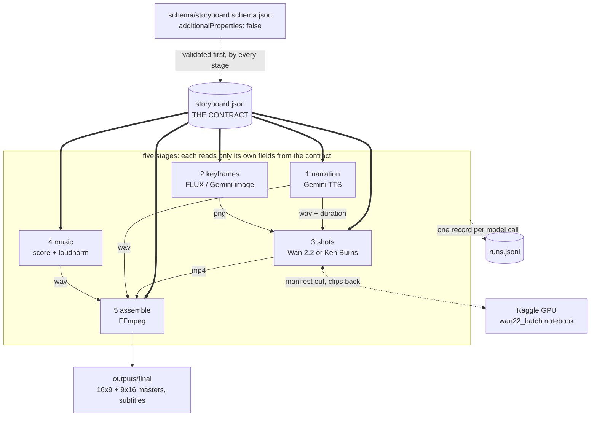

# Architecture

This document describes how `heritage-short` is put together and, where the code falls short of the ideal, says so. Everything here was checked against the code in `pipeline/` and the history in `runs.jsonl`. For setup and usage, start with the [README](README.md).

**Contents:** [1. Data flow and the storyboard contract](#1-data-flow-and-the-storyboard-contract) · [2. Content-addressed caching](#2-content-addressed-caching) · [3. Retry strategy](#3-retry-strategy) · [4. Graceful degradation](#4-graceful-degradation) · [5. Logging contract](#5-logging-contract-runsjsonl) · [6. Artifact layout](#6-artifact-layout) · [7. Known gaps](#7-known-gaps) · [8. Rules for adding a stage](#8-rules-for-adding-a-stage)

---

## 1. Data flow and the storyboard contract

`storyboard.json` is the single source of truth. No stage has its own configuration for the film; each one reads the fields it needs, validates the whole file against `schema/storyboard.schema.json` before doing anything, and writes artifacts into `outputs/`. Stages never call each other. They communicate only through the storyboard and the files in `outputs/`, which is why any stage can be re-run alone.



The field-by-field mapping is in the table below the text view.

Text view, for renderers without Mermaid:

```text
storyboard.json ── validated first by every stage
        │  (each stage reads only its own fields)
        ▼
 1 narration ──► narration/shot_NN.wav ───────────────┐
        │            (duration + pad = shot length)    │
        ▼                                              │
 2 keyframes ──► keyframes/shot_NN.png ──┐             │
                                         ▼             │
 3 shots ──────► shots/shot_NN.mp4  ◄── Kaggle GPU (Wan 2.2), else FFmpeg Ken Burns
        │                                              │
 4 music ──────► music/score_normalized.wav            │
        │                  │                           │
        └──────────────────┴─────────┬─────────────────┘
                                     ▼
 5 assemble ──► final/*_16x9.mp4, *_9x16.mp4 (+ subtitles, end card)

 every stage ──► runs.jsonl
```

### Stage order and dependencies

`make film` runs `validate narration keyframes shots music assemble`, in that order, and `make` stops at the first non-zero exit. The order is not arbitrary:

- **Narration comes before shots** because a shot's length is `narration duration + pad_after_s`. Audio drives picture, not the other way round (the "radio cut first" principle in [DESIGN.md](DESIGN.md)).
- **Keyframes come before shots** because each clip animates its keyframe.
- **Music is independent** of the other stages; it only has to exist before assemble.
- **Assemble depends on everything** and is the only stage that is not cached.

`radio_cut.py` (black-screen audio-pacing preview) and `ceiling_multilingual.py` (TTS language experiment) sit outside `make film`.

### Which storyboard fields each stage reads

| Field | narration | keyframes | shots | music | assemble |
|---|:-:|:-:|:-:|:-:|:-:|
| `project.language` | ● | | | | |
| `project.style_block_short` | | ● | | | |
| `project.fps` | | | ● | | ● |
| `project.music.*` (`caption`, `bpm`, `key`, `seed`, `duration_s`, `selected_file`) | | | | ● | |
| `project.title`, `project.end_card_text` | | | | | ● |
| `project.negative_prompt_video` | | | manifest only | | |
| `shot.narration_text`, `tts_voice`, `tts_style` | ● | | | | |
| `shot.image_prompt` | | ● | | | |
| `shot.seed` | | ● | ● | | |
| `shot.motion_prompt`, `ken_burns_motion` | | | ● | | |
| `shot.video_mode` | | | ● | | ● |
| `shot.pad_after_s` | | | ● | | ● |
| `shot.subtitle_en` | | | | | ● |

Not consumed by any stage (documentation and prompt-authoring fields): `project.style_block`, `character_bible` (except `keyframes.py --ref-sheet`), `character_tokens`, `set_geography`, `props_glossary`, `render_targets`, `generation_notes`, and per shot `reason`, `camera`, `characters_in_frame`, `eyeline`, `continuity`, `foley`, `video_negative_extra`. Editing them invalidates nothing. In particular `render_targets` suggests 1344×768 / 768×1344 keyframes, but `keyframes.py` defaults to 1024×1024 and `make film` passes no size flags.

### The schema as a guard rail

`schema/storyboard.schema.json` sets `additionalProperties: false` at every level, so a misspelled field (`narration_txt`) fails validation instead of silently doing nothing. It also enforces 8–12 shots, `shot_NN` ids, the `video_mode` enum (`wan22` | `ken_burns`), the four `ken_burns_motion` values, `pad_after_s` in [0, 5], and `subtitle_en` ≤ 80 characters. `validate_storyboard()` in `pipeline/utils.py` returns the parsed storyboard or raises a `ValueError` listing every failing field path. Most stages call it with the default relative paths (`storyboard.json`, `schema/storyboard.schema.json`), so **run them from the repository root**.

---

## 2. Content-addressed caching

Every cacheable stage uses the same three helpers from `pipeline/utils.py`.

**Hash.** `compute_input_hash(payload)` serializes a dict with `json.dumps(payload, sort_keys=True, ensure_ascii=False)`, takes its SHA-256, and keeps the **first 12 hex characters** (48 bits). Key order cannot change the hash; any change to a value does.

**Sidecar.** After producing an artifact, the stage calls `write_cache_meta(path, hash, extra)`, which writes `<artifact>.meta.json` containing `input_hash` plus informational extras (model, seed, latency, duration…).

**Check.** `check_cache(path, hash)` is true only if the artifact exists, its sidecar exists, and the sidecar's `input_hash` equals the freshly computed hash. On a hit the stage prints `[CACHE HIT]` and does no work.

Two properties follow, and both matter:

- The key is a hash of the **inputs**, not of the artifact bytes. Editing or truncating a cached file by hand will not be noticed; deleting it (or its sidecar) forces a rebuild.
- Anything **not** in a stage's payload cannot invalidate it. The "not in hash" column below is where stale outputs come from.

### What is hashed, per stage

| Stage | Artifact | Hash payload (any change here invalidates) | **Not** in the hash |
|---|---|---|---|
| Narration | `outputs/narration/<id>.wav` | `language` (= `project.language`), `narration_text`, `tts_style`, `tts_voice` | Which Gemini model actually answered; `pad_after_s`; `seed`. Note: `tts_style` is hashed but never sent to the API, so editing it re-synthesizes identical text with the same voice. |
| Keyframes | `outputs/keyframes/<id>.png` | `full_prompt` (= `image_prompt` with trailing `.` stripped, then `". " + project.style_block_short`), `seed`, `model` (the resolved model id, e.g. `@cf/black-forest-labs/flux-2-klein-9b`), `width`, `height` | `shot_id`; `character_bible`; `style_block`. Switching `--model` or size therefore regenerates everything. |
| Shots | `outputs/shots/<id>.mp4` | `shot_id`, `keyframe_path` (the path string, normalized to `/`), `motion_prompt`, `motion_type` (= `ken_burns_motion`), `target_duration_s` (= narration duration + `pad_after_s`, rounded to 2 dp), `seed`, `mode` (`wan22` or `ken_burns`) | **Keyframe pixels**; `fps`; output resolution; `negative_prompt_video`. |
| Music | `outputs/music/score_normalized.wav` | `source_audio` (path, normalized), `target_lufs` (−18.0), `caption`, `bpm`, `key`, `seed` | `music.duration_s`; the source file's bytes. |
| Assemble | `outputs/final/*.mp4` | *(none: always rebuilt)* | Everything. Both masters are re-encoded every run. |

**Shots check two hashes.** For one output path (`<id>.mp4`), `shots.py` first checks the `wan22` hash, then the `ken_burns` hash. A Wan clip whose sidecar matches wins; a matching Ken Burns clip is a hit; otherwise it renders a Ken Burns clip. `--force` skips both checks.

### How an edit cascades

```text
narration_text/tts_*  ─► narration hash ─► new .wav ─► new duration ─► shots hash ─► new clip ─► assemble
pad_after_s           ──────────────────────────────────────────────► shots hash ─► new clip ─► assemble
motion_prompt,
ken_burns_motion      ──────────────────────────────────────────────► shots hash ─► new clip ─► assemble
seed                  ─► keyframe hash ─► new .png ┐
                      ─► shots hash ─► new clip ───┴──────────────────────────────────────────► assemble
image_prompt          ─► keyframe hash ─► new .png     (shots hash unchanged: clip is now STALE)
style_block_short     ─► every keyframe hash                   (same staleness)
subtitle_en           ───────────────────────────────────────────────────────────────────────► assemble
```

This is why "edit one field, rerun `make film`" regenerates only that shot for the common edits, and why an `image_prompt` edit needs `python pipeline/shots.py --shot <id> --force` afterward. The same applies after any keyframe regeneration; see [Known gaps](#7-known-gaps).

Cached stages are not logged. `runs.jsonl` records only real attempts, so `cache_hit` is always `false` in it today.

---

## 3. Retry strategy

`with_retries(fn, max_retries=3, base_delay=2.0, retryable_exceptions=(Exception,))` in `pipeline/utils.py`:

- **Attempts:** 1 initial + 3 retries = 4.
- **Backoff:** `base_delay * 2**attempt` → **2 s, 4 s, 8 s** (14 s of sleeping if all retries are used). No jitter and no `Retry-After` handling.
- **What is retryable:** by default, any `Exception`, including non-transient ones such as a 4xx or a missing-config error. Callers may narrow it; `narration.py` and `keyframes.py` do not.
- **Exhaustion:** the last exception is re-raised after a message on stderr.

| Stage | Uses `with_retries`? | Behavior when it finally fails |
|---|---|---|
| Narration | Yes (3 retries, 2 s base) | Caught **per shot**, logged with `status="error"`, loop continues; script exits 1 at the end. `make` then stops before keyframes. |
| Keyframes | Yes (3 retries, 2 s base) | Logged, then **re-raised**: the run aborts at that shot with a traceback. Shots already generated are cached, so a rerun resumes. |
| Shots | No (local FFmpeg) | Ken Burns failure is caught and logged; **exit code stays 0**, and the build only fails later when assemble finds the clip missing. |
| Music, Assemble | No | FFmpeg errors raise `RuntimeError` and abort. |

Two multipliers are worth knowing about:

- **Narration also walks a model chain inside every attempt:** `gemini-3.8-flash-tts` → `gemini-3.8-flash-lite-tts` → `gemini-3.1-flash-tts-preview` → `gemini-3.8-flash` → `gemini-2.5-flash`, and for each model tries the SDK first, then REST. Worst case for one shot is 4 attempts × 5 models × 2 transports = 40 HTTP calls.
- **Quota errors are retried pointlessly.** A free-tier 429 with a multi-hour `retryDelay` is retried three times. This is visible in `runs.jsonl`: the failed 429 records all have `latency_s` of 17–22 s, which is the 14 s of backoff plus request time.

---

## 4. Graceful degradation

The goal is that `make film` produces a watchable film from whatever is available, and that every downgrade is visible in the logs and sidecars.

### Wan 2.2 → FFmpeg Ken Burns

```text
for each shot:
  1. Wan clip at outputs/shots/<id>.mp4 whose sidecar hash == wan22 hash?   ─► [CACHE HIT]  (use it)
  2. Ken Burns clip at the same path whose sidecar hash == ken_burns hash?  ─► [CACHE HIT]
  3. keyframe exists?  no ─► warn, skip this shot (assemble will fail later)
  4. render Ken Burns from the keyframe (zoom_in | zoom_out | pan_left | pan_right),
     length = target_duration_s, write sidecar {model: "ffmpeg_ken_burns", fallback_from: <video_mode>},
     log stage="shots" model="ffmpeg_ken_burns"
```

- A shot with `video_mode: "ken_burns"` goes straight to step 4. A `wan22` shot with no valid Wan clip lands there too, which is why all nine shots are Ken Burns today.
- **Wan always wins when present.** Dropping a valid Wan clip into `outputs/shots/` replaces the fallback (same filename); the next `shots.py` run reports a Wan cache hit.
- **A stale Wan clip degrades silently.** If narration length, `pad_after_s`, `motion_prompt`, or `seed` changes after the Wan run, the Wan hash no longer matches, and that one shot falls back to Ken Burns until Wan is re-run for it.
- **The manifest bakes in the hash.** `shots.py --export-manifest` writes `outputs/shots/wan22_manifest.json` for `wan22` shots only, each with the `input_hash` computed locally. The Kaggle script copies that hash into the clip's sidecar, so what comes back is accepted only if it still matches this checkout's storyboard and narration.
- **Assemble treats clips by storyboard intent, not by what rendered.** It decides on Wan-style trimming (0.25 s cut from the start of any clip longer than 1.5 s) from `video_mode == "wan22"`, so Ken Burns fallback clips for `wan22` shots get the same trim. Worth knowing if you see odd shot endings.

### Kaggle checkpointing

`notebooks/wan22_batch.{ipynb,py}` is written to survive free-tier GPU sessions that die mid-run:

1. **Write after every clip.** Each shot's MP4, its `.meta.json` sidecar, and one line in `kaggle_runs.jsonl` are written **immediately** after that shot finishes, not at the end. A crash or timeout loses at most the clip in flight.
2. **Resume by cache.** On restart, any shot whose sidecar hash matches the manifest is skipped (`[CACHE HIT]`), so you re-run the notebook and it continues where it stopped.
3. **Failures are isolated.** A shot that raises is logged with `status="error"` and its `gpu_min`, and the loop moves on to the next shot.
4. **Memory-lean on a T4.** fp16, `enable_model_cpu_offload()`, VAE slicing and tiling; `DRAFT_MODE = True` renders 832×480 at 20 steps (fast, saves GPU quota), `False` renders 1280×720 at 35 steps.
5. **Bring-home bundle.** The last cell zips `outputs/shots/` (clips, sidecars, `kaggle_runs.jsonl`) into `wan22_shots_bundle.zip`. If the session dies before that cell, the files are still in the Kaggle working directory and must be downloaded by hand.
6. **Log merge.** The next `shots.py` run calls `merge_kaggle_runs()`, which appends lines from `outputs/shots/kaggle_runs.jsonl` to `runs.jsonl`, skipping any whose exact text is already there. `music.py` does the same for `outputs/music/music_runs.jsonl`.

### Other fallbacks in the code

| Situation | Fallback |
|---|---|
| No `selected_file` for music | `music.py` synthesizes a 82 s D-minor ambient pad with the standard library so `make film` never breaks. It does this **before** the cache check, so the pad is re-synthesized on every run. |
| Gemini TTS model unavailable | Narration walks its model chain (see §3). |
| Gemini SDK missing or failing | REST call for the same model. |
| `loudnorm` pass-1 JSON unparseable | Assemble falls back to single-pass loudness normalization. |
| `ffmpeg` not on `PATH` | `imageio_ffmpeg`'s bundled binary. |
| `ffprobe` not on `PATH` | `ffmpeg -i` output parsing, then the `wave` module for WAV files. |
| No TrueType font | Pillow's default font for end card and slides. |

Not automatic: **keyframe model fallback.** Moving between Cloudflare, NVIDIA, and Gemini image models when a quota runs out is a manual `--model` choice. The shipped keyframes are the result of exactly that.

---

## 5. Logging contract (`runs.jsonl`)

`runs.jsonl` is an append-only JSON Lines file at the repository root: UTF-8, one compact JSON object per line, written by `log_run()` in `pipeline/utils.py`. It is the experiment record and the future input to cost reporting.

### Record schema

| Field | Type | Meaning |
|---|---|---|
| `timestamp` | string | ISO-8601 UTC, e.g. `2026-11-26T06:59:15.481632+00:00` |
| `stage` | string | `narration`, `keyframes`, `shots`, `music`, `assemble`, `radio_cut`, `smoke_test`, or an experiment name (`ceiling_multilingual`, `ceiling_translate`) |
| `shot_id` | string \| null | `shot_NN`, `ref_sheet_N`, `master_16x9` / `master_9x16`, `all`, or `null` for project-level work |
| `model` | string | Model or tool id that did the work, e.g. `gemini-3.8-flash-tts`, `ffmpeg_ken_burns` |
| `params` | object | Stage-specific inputs and measurements (shapes below) |
| `seed` | integer \| null | Seed used, if any |
| `latency_s` | number | Wall-clock seconds, rounded to 4 dp. Includes retry backoff for retried calls. |
| `status` | string | `ok` or `error` (the docstring also mentions `cached`, but no stage emits it) |
| `gpu_min` | number | GPU minutes (Kaggle runs); `0.0` elsewhere |
| `est_cost_usd` | number | Estimated cost, 6 dp. **Currently always `0.0`**, hard-coded at every call site. |
| `cache_hit` | boolean | Always `false` in practice: cache hits are not logged |
| `error` | string \| null | Error text when `status` is `error` |

A JSON Schema for validators or `jq`-free tooling:

```json
{
  "$schema": "https://json-schema.org/draft/2020-12/schema",
  "type": "object",
  "required": ["timestamp", "stage", "shot_id", "model", "params", "seed",
               "latency_s", "status", "gpu_min", "est_cost_usd", "cache_hit", "error"],
  "properties": {
    "timestamp":    {"type": "string", "format": "date-time"},
    "stage":        {"type": "string"},
    "shot_id":      {"type": ["string", "null"]},
    "model":        {"type": "string"},
    "params":       {},
    "seed":         {"type": ["integer", "null"]},
    "latency_s":    {"type": "number", "minimum": 0},
    "status":       {"enum": ["ok", "error", "cached"]},
    "gpu_min":      {"type": "number", "minimum": 0},
    "est_cost_usd": {"type": "number", "minimum": 0},
    "cache_hit":    {"type": "boolean"},
    "error":        {"type": ["string", "null"]}
  },
  "additionalProperties": false
}
```

### Rules

1. **Log when a model call is attempted, not on a cache hit.** One record per attempt sequence (all retries collapsed into one), with `latency_s` covering the whole sequence.
2. **Log failures too**, with `status="error"` and the message, so error rates can be computed from the file.
3. **Remote runs write to side files**, not to `runs.jsonl`: `outputs/shots/kaggle_runs.jsonl` and `outputs/music/music_runs.jsonl`. They are merged by exact-line deduplication at the start of the next `shots.py` / `music.py` run.
4. **Never log secrets.** See the hygiene note below.

### `params` by stage (as observed)

| Stage | `params` keys |
|---|---|
| `narration` | `language`, `narration_text`, `tts_style`, `tts_voice` |
| `keyframes` | `prompt`, `output_path`, `width`, `height` |
| `shots` (Ken Burns) | `motion_type`, `target_duration_s`, `fps`, `fallback_from` |
| `shots` (Wan, from Kaggle) | `draft_mode`, `resolution`, `num_inference_steps`, `guidance_scale`, `target_duration_s` |
| `music` (`music.py`) | `source_model`, `source_file`, `target_lufs`, `duration_s`, `bpm`, `key` |
| `music` (ACE-Step runner, from Kaggle) | `variant`, `caption`, `bpm`, `keyscale`, `duration_s`, `steps`, `quantization`, `offload_to_cpu`, `instrumental`, `output_file`, `peak`, `actual_duration_s`, `sample_rate` |
| `assemble` | `aspect_ratio`, `resolution`, `duration_s`, `duck_threshold`, `duck_ratio`, `measured_lufs`, `burned_subtitles` |
| `radio_cut` | `resolution`, `fps`, `has_ambient`, `num_shots` |
| `ceiling_multilingual` | `language`, `voice`, `text`, `words`, `attempts`, `wall_s`, `duration_s`, `words_per_s`, `suspect`, `suspect_reason` |

### Reading it

```bash
# error rate and mean latency per stage and model
python - <<'PY'
import json, collections
rows = [json.loads(l) for l in open("runs.jsonl", encoding="utf-8") if l.strip()]
agg = collections.defaultdict(lambda: [0, 0, 0.0])
for r in rows:
    a = agg[(r["stage"], r["model"])]
    a[0] += 1; a[1] += r["status"] == "error"; a[2] += r["latency_s"]
for (stage, model), (n, e, t) in sorted(agg.items()):
    print(f"{stage:<10} {model:<42} n={n:<3} err={e:<3} mean_latency={t/n:.1f}s")
PY
```

### Known inconsistencies in the current log

At the time of writing it holds 86 records (60 ok, 26 error), and a reader should know that:

- `est_cost_usd` is always `0.0` and is an assertion, not a measurement; `COSTS.md` is generated by `pipeline/report_costs.py` (`make costs`), which also prices the work at benchmark list rates.
- The 10 narration failures labelled `model: "gemini-tts"` are not model failures: nine are "GEMINI_API_KEY is required" from an early run without a key, and one is an HTTP 404. Narration success records carry the actual model that answered.
- `assemble` records have `latency_s: 0.0` (not measured).
- One `shots` record has `shot_id: "test_merge"` and empty `params`; it is the only record with `gpu_min` > 0 (0.41) and was a log-merge test.
- Any `music` record labelled plain `"ACE-Step-1.5"` came from the **old** notebook, which actually ran `facebook/musicgen-small` (or a synthetic fallback). The current runner labels records `ACE-Step-1.5/<dit config>` (e.g. `ACE-Step-1.5/acestep-v15-sft`) and logs failures as errors with no fallback. `music.py` still labels any user-selected score `source_model: "ACE-Step-1.5"` without checking where the file came from.

**Secret hygiene.** Gemini REST calls in `narration.py`, `keyframes.py`, and `smoke_test.py` put the API key in the URL query string. `requests` exceptions can embed the URL, so a connection error could write the key into `error` and therefore into a committed file. The current `runs.jsonl` contains none (checked), and `.env` is git-ignored. Header authentication (`x-goog-api-key`), as `ceiling_multilingual.py` uses, avoids the risk.

---

## 6. Artifact layout

```text
outputs/
├── narration/    shot_NN.wav            24 kHz mono 16-bit  (+ .meta.json: input_hash, duration_s, model, latency_s)
├── keyframes/    shot_NN.png            1024×1024 by default (+ .meta.json: input_hash, model, seed, full_prompt, width, height)
│                 ref_sheet_0..3.png     only from keyframes.py --ref-sheet
├── shots/        shot_NN.mp4            Wan 2.2 or Ken Burns clip (+ .meta.json: input_hash, model, fallback_from …)
│                 wan22_manifest.json    exported for Kaggle
│                 kaggle_runs.jsonl      returned from Kaggle, merged into runs.jsonl
├── music/        score_cand_<variant>_<seed>.wav  ACE-Step candidates from the Kaggle notebook (pick one as selected_file)
│                 score_placeholder.wav  procedural pad (only when no selected_file)
│                 score_normalized.wav   −18 LUFS master score (+ .meta.json)
│                 music_runs.jsonl       returned from Kaggle/Colab, merged into runs.jsonl
└── final/        <title>_16x9.mp4       1280×720, 24 fps, H.264 + AAC 192k @ 48 kHz, ≈ −14 LUFS
                  <title>_9x16.mp4       720×1280, centre-cropped from the same clips
                  subtitles_16x9.ass, subtitles_9x16.ass
                  radio_cut.mp4          audio-pacing preview
```

`assemble.py` builds the audio spine (narration with `pad_after_s` gaps, plus the looped and faded score), ducks the score under speech with `sidechaincompress` (threshold 0.02, ratio 6, attack 300 ms, release 1500 ms), runs two-pass `loudnorm` to −14 LUFS / −1 dBTP, burns the ASS subtitles (9:16 keeps a 240 px bottom margin clear of platform UI), and appends a programmatic 2.5 s AI-disclosure end card.

---

## 7. Known gaps

Listed by impact. Each one is a real behavior of the current code, not a hypothetical.

1. **The shot cache ignores keyframe contents.** Its hash holds the keyframe *path*. Regenerating a keyframe (new `image_prompt`, new model, new `style_block_short`) leaves the old clip in place. Fix: add the keyframe's own `input_hash` (from its sidecar) to the shot payload.
2. **`keyframes.py` demands a key before checking the cache.** With the default `nvidia-flux3` and no `NVIDIA_API_KEY`, it raises immediately, even if every keyframe is cached. `NVIDIA_API_KEY` is also missing from `.env.example`.
3. **The model is part of the keyframe hash, and `make film` pins the default.** The committed keyframes use two models, so a plain `make film` regenerates `shot_04`–`shot_09`. `make keyframes` cannot take a `--model` argument.
4. **Keyframes ignore `render_targets`.** They are 1024×1024 unless `--width/--height` are passed; the storyboard suggests 1344×768 and 768×1344.
5. **Assemble is uncached.** Cheap (FFmpeg only) but it re-encodes every shot for both aspect ratios on each run.
6. **`est_cost_usd` is hard-coded to 0**, and neither cache hits nor per-call retry counts are logged, so `make costs` can only report them as not recorded.
7. **Music provenance is unchecked.** `music.py` labels any `selected_file` as ACE-Step without verifying it, and candidates from the old MusicGen-based notebook (CC-BY-NC) must not be shipped (see §5).
8. **Quota errors are retried** with no regard for `retryDelay` (see §3).
9. **`tts_style` is hashed but unused** by the TTS call.
10. **Placeholder music is re-synthesized every run** before the cache is consulted.

---

## 8. Rules for adding a stage

Follow the pattern the existing stages share, so the stage composes with the rest:

1. Call `validate_storyboard()` first; read only fields that are in the schema.
2. Hash **every** input that changes the output (including upstream artifacts' hashes, not just their paths), and nothing that doesn't.
3. Write the artifact, then its `.meta.json` sidecar; treat artifact plus sidecar as one unit.
4. Wrap network calls in `with_retries()`, narrowing `retryable_exceptions` to transient errors, and honor `Retry-After` where the API provides it.
5. Log one `runs.jsonl` record per real attempt, success or failure, with a truthful `model` label.
6. Decide the degraded mode up front (what is produced if the model is unavailable) and record it in the sidecar so downstream stages and humans can see it.
7. Authenticate with headers, never query strings, so errors stay safe to log.
